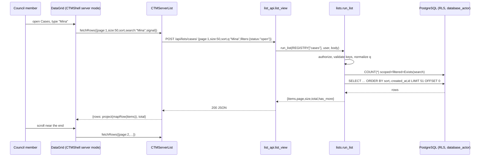

# ctm3-312 — server-paged lists (G3 design)

Issue: LighthouseCollection/CTM#312 (part of #311, owner rule 5). Brief: `brief.md`. ADR: `docs/adr/0001-server-list-queries.md`.
Contract examples: `contract/post-list-*.json` (backend asserts them; frontend fixtures load them).

## 1. Approaches

| Option | How | For | Against |
|---|---|---|---|
| **A. One `POST /api/lists/<name>/` endpoint and a list registry (recommended)** | New `tribunal/lists.py` (rules per list and role) + `tribunal/list_api.py` (one view). The body carries page, size, sort, q, filters | Search text stays out of URLs and logs, as `POST /api/search/` already does. One permission place for counts and search. `api.py` does not grow. Existing GETs keep working while screens move | Reads through POST are not HTTP-cacheable; #308's memory cache must key on path + body |
| B. Query parameters on each existing GET | `?page=&size=&sort=&q=` on today's views in `api.py` | Cacheable, no new route | Names typed in search land in access logs (breaks the `runSearch` rule). Seven views in `api.py` grow, and the rules are repeated in each |
| C. Keyset cursors | `after=<created_at,id>` | Stable under inserts | Plenix "pages" mode jumps to page N and shows a total; needless at thousands of rows |

**Recommendation: A.** It is the only option that keeps search text out of logs and puts every count rule in one tested place.

## 2. Global constraints (verbatim)

- Plenix pin: `PLENIX_BASE = "https://design-system.lighthouseway.org/cdn/1.6.1/"` (`ctm/settings.py`). Component docs: `data-grid.md` (`mode`, `fetchRows`, `pageSize`), `use-collection-view.md`, `command-bar.md`, `listing-page.md`.
- Acceptance IDs: AC-1 … AC-10 (`brief.md`); SEC01 "Applicant A cannot read B's fields, files, reports, medical release, messages, histories, counts, search snippets or range URLs."; SEC02 "Council cannot read unsubmitted applicant draft, including index/preview; historical staging has explicit publisher boundary."; SEC03 "Unrelated council member can read submitted case but cannot mutate assigned-only resources; suspension/reassignment invalidates stale permissions."; UI01 "Every screen uses documented Plenix0.58.0 [now the pinned version]; runtime inline-style checks and English/Arabic RTL flows pass; only isolated Arabic exception."
- Error codes (unchanged, from `api.endpoint`): `401 authentication_required`, `403 forbidden {detail}`, `404 resource_or_input_invalid`, `405 method_not_allowed`, `422 validation {messages[]}`. Exact 422 messages are in the contract files.
- Permission rows (`build-spec/permissions.md`): "Read never-submitted applicant draft: Own / No / No / No by default / No"; "Read submitted case: Own permitted projection / All cases / All cases / All cases / All cases if council"; "Case audit: Own answer history only / Yes / Yes / Yes / Yes"; "System audit: No / No / No / Yes / Only with admin/secretary role"; "Add council member: … Existing admin only"; "Deactivate/reactivate/change roles: … Admin/secretary".
- Locked screen decisions: D-0046 (Home My cases is a `DataGrid mode="pages" pageSize={10}`); D-0064 (no skeletons; Plenix `LoadingState` spinner after about a second); D-0034 (every list goes through `CTMShell`); D-0049 (New applications has two views: Awaiting review, For council).

## 3. Data

- No new tables, columns or `schema.json` names. Every response item is an existing projection, unchanged: `_case_list_data` + `display_status` + `next_step` (cases), `application_data` (applications), `session_data` (sessions), `member_data` (members), `account_data` (accounts), the audit encoders in `case_audit`/`system_audit`.
- Migration (owner `database`): `tribunal/migrations/0078_list_indexes.py`, indexes only, with matching `Meta.indexes` in `tribunal/models.py`:
  - `AuditEvent(-created_at, -id)` name `audit_created_idx`; `AuditEvent(case, -created_at, -id)` name `audit_case_created_idx`
  - `Case(-created_at, -id)` name `case_created_idx`; `Case(status, -created_at)` name `case_status_created_idx`
  - `Party(case, slot)` exists as a unique constraint, so no new index.
  - Build with `AddIndexConcurrently` (`atomic = False`). The audit table is the largest.

## 4. Service commands

Read-only, so there are no mutations, locks, history rows or outbox events. The query engine is in `tribunal/lists.py`:

```python
@dataclass(frozen=True)
class ListSpec:
    name: str                                   # "cases"
    authorize: Callable[[Account], None]        # raises PermissionDenied
    queryset: Callable[[Account], QuerySet]     # already scoped to what the actor may read
    serialize: Callable[[Model, Account], dict] # existing projection
    sorts: Callable[[Account], dict[str, Expr]] # allowed sort keys for this actor -> ORM expression
    default_sort: tuple[str, ...]               # e.g. ("-created_at", "-id"); "id" tiebreak always appended
    filters: Callable[[Account], dict[str, Callable[[QuerySet, Any], QuerySet]]]  # key -> validator+applier
    search: Callable[[Account], Callable[[QuerySet, str], QuerySet] | None]       # None: q must be ""
    visible: Callable[[Model], bool] | None = None  # Python visibility -> total is None
    facets: Callable[[], dict[str, list[str]]] | None = None

REGISTRY: dict[str, ListSpec]

def run_list(spec: ListSpec, actor: Account, data: dict) -> dict:
    """Validate data, then return {items, page, size, total, has_more[, facets]}."""
```

`run_list` order (fixed):
1. `spec.authorize(actor)`.
2. Validate the body keys: only `page, size, sort, q, filters, facets` are accepted.
3. Validate `page` (1..1,000,000; default 1), `size` (1..100; default 50) and `sort` (≤3 entries; each `field` must be in `spec.sorts(actor)`; `dir` asc|desc).
4. Validate `q`: NFC, trim, Arabic-Indic and Eastern Arabic-Indic digits mapped to ASCII, tatweel (U+0640) removed. Empty, or 2..200 characters.
5. Run each filter applier in key order. A key missing from `spec.filters(actor)` is refused with 422, or with 403 when the key exists only for council roles.
6. Search: `spec.search(actor)(qs, q)` uses `Exists()` subqueries, never joins, so rows are never repeated and totals never inflate.
7. Order by the sort list, then `spec.default_sort`, then `id`.
8. Without `visible`: `total = qs.count()`; `rows = qs[(page-1)*size : page*size + 1]`. With `visible`: iterate `qs.iterator(chunk_size=250)`, skip hidden rows, `islice` (same as `pagination.page_records`); `total = None`.
9. `has_more = len(rows) > size`; `items = [serialize(r) for r in rows[:size]]`.

### List registry (exact)

| Name | Authorize | Queryset | Filters (key: values) | Search fields (`icontains` unless said) | Sort keys | Default sort |
|---|---|---|---|---|---|---|
| `cases` | `active` | applicant: `Exists(Party case=pk, account=actor)`; council: all | all roles: `status`: open\|closed\|any (default any); `ids`: 1..100 UUIDs. Council only: `mine`: true (assigned_member=actor); `assigned`: "none"; `ground`: one of the six ground codes (matched in the submitted revision answers, same rule as `submitted_grounds`) | applicant: `number` only. Council: `number`, any `Party.name` of the case, assigned member `first_name`/`last_name` | applicant: `number`, `created_at`, `status`. Council adds: `closed_at`, `applicant_name`, `respondent_name`, `assigned_member` | `-created_at` |
| `applications` | `active` | `visible_applications(actor)` (applicant: own; council: `submitted_at` not null, SEC02) | `kind`: petition\|appeal. Council only: `state`: awaiting_review\|council_consideration (same `Q` as the GET view today); `case`: UUID | applicant: none (q must be ""). Council: `case__number`, `party__name` | `created_at`, `submitted_at`, `case_number` (`case__number`) | `created_at` asc (oldest first, as today) |
| `sessions` | `staff` | `CouncilSession` annotated with `assigned_case_count` and `hearing_case_count` (as today) | `view`: current\|upcoming\|archived, with LA today `= timezone.localdate(timezone=ZoneInfo("America/Los_Angeles"))`: current = state in (draft, planned) and date ≤ today; upcoming = same states and date > today; archived = state closed. Also `state`, `date_from`, `date_to` (YYYY-MM-DD, as today) | `location`; a q matching `CS\d{8}` or `\d{4}-\d{2}-\d{2}` matches `date` exactly | `date`, `starts_at` | view upcoming: `date` asc; otherwise `-date` |
| `members` | `existing_admin` | `member_queryset()` | `role`: member\|president\|secretary\|admin; `active`: bool | `first_name`, `last_name`, `email` | `last_name`, `first_name`, `email`, `role`, `created_at`, `active_case_count` (`_active_case_count`) | `-created_at` |
| `accounts` | `administrator` | `account_queryset()` | `role`: applicant\|member\|president\|secretary\|admin; `active`: bool | `first_name`, `last_name`, `email` | `last_name`, `email`, `role`, `created_at` | `-created_at` |
| `audit` | `administrator` | `AuditEvent.objects.all()`; `visible=audit_visible` | `action`, `source` (exact strings, ≤100 chars); `date_from`, `date_to` (LA civil days: from 00:00 LA to the next day's 00:00 LA, converted with `zoneinfo`, so DST days are 23 or 25 hours) | `action`, `source` | `created_at` | `-created_at` |
| `case-audit` | `staff`, then `case_for(actor, filters.case)` | `AuditEvent(case=case)`; `visible=audit_visible` | `case` (required UUID), `action`, `source`, `date_from`, `date_to` | `action`, `source` | `created_at` | `-created_at` |

Annotations for the council case sort keys, in `tribunal/lists.py`, mirroring `_case_list_data`:
- `list_applicant_id = Coalesce(Subquery(petition with submitted_at, newest submitted_at then id, .party_id), Subquery(Party by slot asc, first .pk))`.
- `applicant_name = Subquery(Party pk=OuterRef("list_applicant_id") .name)`.
- `respondent_name = Subquery(Party case=OuterRef, ~pk=OuterRef("list_applicant_id"), by slot, first .name)`.
- `assigned_member` sorts by `(assigned_member__last_name, assigned_member__first_name)` with nulls last.

Facets (`audit` only): when `facets: true` and `page == 1`, the response adds `facets: {action: [...], source: [...]}`. These are sorted distinct codes over `AuditEvent`, with no counts. They are system vocabulary written by `services.common.audit`, never record data.

Messages and notifications: already server-paged (offset, 50 rows, `next_offset`). They are not in the registry and stay unchanged (AC-7).

## 5. Authorization and derivative surfaces

Rules every list follows (AC-8, SEC01, SEC02):
1. **The total counts only readable rows.** The count runs on the same queryset object as the page, after authorization, filters and search. No count is computed before scoping.
2. **Python visibility means no count.** A list that hides rows in Python returns `total: null`. The grid count bar then shows no number (see section 8).
3. **Search only what the actor can read.** An applicant can search only `number`. Searching spouse or party names would reveal, through hits and counts, data the applicant may not read (SEC01). An applicant sending q to `applications` gets 403.
4. **Sort only what the actor can read.** Order leaks values. Applicants get no name or manager sort keys.
5. **Unknown is refused.** A filter, sort or body key outside the list's rules gets 422 (403 for council-only keys), never a silently wider result.
6. **Out-of-scope ids return nothing, not a refusal.** `ids` and `case` return only rows the actor may read. An applicant asking for another case's id gets `items: []`, `total: 0`, never 403, so nothing reveals that the case exists. Exception: `case-audit` uses `case_for`, as the GET does today.
7. **Joins never inflate totals.** Search and filters on parties use `Exists`, never `parties__name__icontains` joins.
8. **Re-checked every page.** Each page request re-runs `active()` and `authorize`. A member suspended mid-scroll gets 403 on the next page (SEC03).

Surfaces:

| Surface | Rule |
|---|---|
| RLS | Requests run inside `database_actor` (`tribunal/middleware.py`). Policies on `tribunal_case`, `tribunal_application`, `tribunal_account`, `tribunal_councilsession` already apply to the `COUNT` and the page. No RLS change |
| Logs | q travels in the POST body. `list_api.py` logs nothing about the request. The access log has the path only |
| Celery / emails | None |
| Links | Items carry the same URLs as today (`status_history_url`); no new links |
| Search snippets | None (rows only) |
| Facets | Admin/secretary only, codes only, no counts |

## 6. API contract

`POST /api/lists/<name>/`. Session cookie, `X-CSRFToken` (the `api()` helper already sends it), `Content-Type: application/json`. Body ≤ 1 MiB (`api.body`).

Request body:
```json
{"page": 1, "size": 50, "sort": [{"field": "number", "dir": "desc"}], "q": "", "filters": {"status": "open"}, "facets": false}
```
Response `200`:
```json
{"items": [ … ], "page": 1, "size": 50, "total": 123, "has_more": true}
```
`total` is an integer or `null`. A page past the end returns `items: []` and the real `total`.

| Name | Contract file |
|---|---|
| cases | `contract/post-list-cases.json` |
| applications | `contract/post-list-applications.json` |
| sessions | `contract/post-list-sessions.json` |
| members | `contract/post-list-members.json` |
| accounts | `contract/post-list-accounts.json` |
| audit | `contract/post-list-audit.json` |
| case-audit | `contract/post-list-case-audit.json` |

Each file has `request`, `response` and `errors[]` (`when`, `status`, `body`). The common errors (401, 405, CSRF 403, unknown list 404, page/size/sort/q/filter 422) repeat in every file.

## 7. Failure paths

There are no async or external steps. One list request can fail as follows:

| Case | Person sees | DB state | Log | Recovery |
|---|---|---|---|---|
| Happy | Rows; next page loads on scroll ("fill") or page click ("pages") | Unchanged | None | — |
| Validation (bad sort/filter) | Plenix error row with Retry; a programming error, caught by contract tests | Unchanged | Django 422 line, no body | Fix the caller |
| Timeout / transient (network, 5xx) | Plenix "Loading records" row turns into a row with Retry; rows already shown stay | Unchanged | Server error log if 5xx | Retry calls `fetchRows` again for the same page |
| Permanent (403 after suspension, SEC03) | Retry row; the next shell request signs the person out (401 → `setUser(null)`) | Unchanged | 403 line | Sign in again |
| Partial (rows added or removed between pages) | Possible repeat or skipped row with offset pages | Unchanged | — | Adapter drops repeated ids. A skipped row appears on the next search, sort change or reload |
| Concurrent search change | The old request is aborted (Plenix `signal`, passed to `fetch`); only the newest answer is drawn | — | — | — |

## 8. UI plan

- `CTMShell` (`static/ctm/shell-layout.js`) gets one new optional prop on `Table`, `Listing` and `Workspace`:
  `server: { list, filters, size, mode, mapRow }`
  - With `server`, `rows` is ignored. `DataGrid` gets `mode` (default `"fill"`), `pageSize` (`size`, default 50), `fetchRows` and `search` (the `CommandBarSearch` text, debounced 300 ms).
  - Columns: each column may set `serverSort: "<sort key>"`. Columns without it get `sortable: false`. Every column gets `groupable: false`, because grouping one page misleads. `useCollectionView` still drives the search box, but its `filter` and `sort` are not passed to the grid.
  - `fetchRows({page,size,sort,search,signal})` → `CTMServerList.query(api, list, {page, size, sort: mapped, q: search, filters})`. Sort fields map from `__ctm_display_<i>` to `columns[i].serverSort`. Then `project(items.map(mapRow), columns)` runs, ids already loaded are dropped, and it returns `{rows, total}`. When `total` is null: `total = has_more ? page*size + 1 : (page-1)*size + rows.length`.
  - `cardCount` is not passed when `total` is null (audit), so no estimated number is shown.
- New `static/ctm/server-list.js`: `window.CTMServerList = Object.freeze({ query(api, list, body, signal), byIds(api, list, ids) })`. `byIds` asks for chunks of 100 ids with `size: 100` and returns a `Map` from id to row.
- Screens:

| Screen | List | Mode / size | Filters sent | Search placeholder (existing key) |
|---|---|---|---|---|
| Cases (all active), `CasesTable` | cases | fill / 50 | `status: open` or `any` (Show closed toggle) | `searchCases` |
| My cases, `CasesTable view="mine"` | cases | fill / 50 | `mine: true, status: open` or `any` | `searchCases` |
| Archived, `CasesTable archived` | cases | fill / 50 | `status: closed` | `searchCases` |
| Home My cases (D-0046) | cases | pages / 10 | `mine: true, status: open` | — |
| New applications: Awaiting review / For council | applications | fill / 50 | `state` | existing review search key |
| Home review queue panel | applications | `size: 5` via `query`, shows `total` in the badge | `state: awaiting_review` | — |
| Sessions current / upcoming / archived, `SessionList` | sessions | fill / 50 | `view` | — |
| Users and roles, `MemberDirectory` | members | fill / 50 | `role`, `active` from its filters | existing |
| System audit, `Administration` | audit | fill / 50 | `action`, `source`, `date_from`, `date_to`; the Select options come from `facets` | `query` field |
| Case audit (council-case) | case-audit | fill / 50 | `case` | — |

- Strings: the DataGrid loading row, retry row and load failure use the grid's `strings`. Their exact keys are checked in `data-grid.md` 1.6.1 by the frontend task. If keys are missing, use these CTM keys in `council.js` and `ui-workspaces.js` translators:
  - `listLoadingMore`: "Loading records" / "جارٍ تحميل السجلات"
  - `listRetry`: "Retry" / "إعادة المحاولة"
  - `listLoadFailed`: "The records could not be loaded." / "تعذّر تحميل السجلات."
  - The Arabic strings are proposals, routed through `docs/i18n/arabic-proposals.md` (D-0012).
- States: loading = `CTMShell.DelayedSpinner` for the first page (D-0064), then the Plenix loading row; empty = the existing `empty` keys; error = Plenix Retry row; forbidden = the existing `unavailable` notice; read-only = archived lists keep `P.ReadOnly`.

## 9. Sequence



## 10. Hotspot change plan

| File | Added | Modified | Removed |
|---|---|---|---|
| `tribunal/api.py` | nothing | nothing | nothing (GET lists stay until a later slice) |
| `static/ctm/app.js` | — | page loader (`R.useEffect` near "else if (page === \"sessions\")"): for `user.portal === "council"`, the pages `cases`, `myCases`, `archived`, `home` resolve `Promise.resolve({})` (the council module loads its own pages); the applicant branch is unchanged | — |
| `static/ctm/council.js` | `serverCaseRow(row, t)` (the row mapping now inline in `CasesTable`) | `CasesTable` (server prop, drops `cases` prop use), `caseRows` (kept only for the applicant path), Home `casesRegion` (`/api/cases/?mine=1` → lists `cases` pages/10), `ReviewQueuePanel` and the review workspace list (`REVIEW_URL`/`CONSIDERATION_URL` → lists `applications`), `SessionList` (`sessionBuckets` replaced by the `view` filter; the answers fetch stays per visible row), session agenda loader (`api("/api/cases/")` → `CTMServerList.byIds(api, "cases", agenda case ids)`), search workspace (`api("/api/cases/")` → `byIds` of the result case ids) | `sessionBuckets` when no caller is left |
| `static/ctm/council-case.js` | — | report panel loader (`caseRow: cases.items.find` → `byIds(api,"cases",[caseId])`), decision loader at the `api("/api/council/members/"), api("/api/cases/")` pair (same), `casePetitions` caller (`api("/api/applications/")` → lists `applications` `filters.case`), case audit loaders (`/api/cases/<id>/audit/` → lists `case-audit`) | — |
| `static/ctm/council-decree.js` | — | loader at `Promise.all([api("/api/applications/"), …])` → lists `applications` `filters.case` | — |
| `static/ctm/council-media.js` | — | — | — |

Out of scope, follow-up issue: the Statistics page (`caseStatistics(cases.items, …)` in `council.js`) needs a server aggregate, not a list. `withAssignee` keeps its legacy fallback.

## 11. Owners

```owners
architect: docs/implementation/slices/ctm3-312-server-lists/brief.md, docs/implementation/slices/ctm3-312-server-lists/design.md, docs/implementation/slices/ctm3-312-server-lists/contract/*.json, docs/adr/0001-server-list-queries.md
database: tribunal/migrations/0078_list_indexes.py, tribunal/models.py
backend: tribunal/lists.py, tribunal/list_api.py, ctm/urls.py, tests/test_list_contract.py, tests/test_list_privacy.py, tests/test_list_timing.py, docs/implementation/slices/ctm3-312-server-lists/evidence.md
frontend: static/ctm/server-list.js, static/ctm/shell-layout.js, static/ctm/council.js, static/ctm/council-case.js, static/ctm/council-decree.js, static/ctm/ui-workspaces.js, static/ctm/app.js, tribunal/templates/tribunal/shell.html, tests/frontend/server-list.test.cjs, tests/frontend/council-server-lists.test.cjs, tests/frontend/table-contract.test.cjs
i18n: docs/i18n/arabic-proposals.md
```

Manifest: [NEW] `tribunal/lists.py`, `tribunal/list_api.py`, `tribunal/migrations/0078_list_indexes.py`, `static/ctm/server-list.js`, the four new test files. Everything else is [MODIFY].

## 12. Tasks

Run tests with `uv run pytest --ds=ctm.settings_postgres_test -q <file>` (needs `CTM_TEST_DATABASE_URL`) and `node --test <file>`.

**T1. database: list indexes.** Files: `tribunal/models.py` (Meta.indexes on `Case`, `AuditEvent`), `tribunal/migrations/0078_list_indexes.py`. Depends: none. Parallel-safe: yes. Interfaces: produces the index names in section 3.
- write failing test: none (schema only) -> run `uv run python manage.py makemigrations --check --dry-run --settings=ctm.settings_test`, expect FAIL after the Meta edit -> write `0078` with `AddIndexConcurrently`, `atomic = False` -> run again and `node scripts/check_migration_diff.cjs`, expect PASS -> commit.

**T2. backend: list engine, route, cases.** Files: `tribunal/lists.py`, `tribunal/list_api.py`, `ctm/urls.py` (one line: `path("api/lists/<slug:name>/", list_api.list_view)`), `tests/test_list_contract.py`. Depends: none. Parallel-safe: yes (with T1, T5). Interfaces: produces `ListSpec`, `REGISTRY`, `run_list(spec, actor, data) -> dict`, `list_view(request, name)` (`@endpoint(("POST",))`, `REGISTRY.get(name)` missing → raise `ObjectDoesNotExist`); matches `contract/post-list-cases.json`.
- write failing test `test_cases_contract_example` (seed the fictional rows of the contract file; POST its request; assert status and that the body keys and item keys equal the contract response) -> run, expect FAIL (404) -> implement engine + `cases` spec -> run, expect PASS -> commit.
- write failing tests `test_list_common_errors` (parametrized over every `errors[]` entry common to all files: 401, 405, unknown list 404, page 0, size 101, sort `secret`, 4 sort entries, q "a", filter `nope`, body key `offset`) -> run, expect FAIL -> implement validation -> PASS -> commit.
- write failing test `test_case_search_total_distinct` (one case whose two parties are both named "Demo Mina …"; q "Mina" → `total == 1`, one item) -> FAIL -> use `Exists` -> PASS -> commit.
- write failing test `test_case_sort_applicant_name_matches_projection` (3 cases, sort `applicant_name` asc; the order equals sorting by each item's `applicant_name`) -> FAIL -> annotations -> PASS -> commit.
- write failing test `test_case_search_arabic_digits` (q "٢٠٢٦١٠٢٠-٠٤" finds `20261020-04`; q with a tatweel finds the name without it) -> FAIL -> normalize q -> PASS -> commit.
- write failing test `test_case_page_past_end` (page 99 → `items == []`, real `total`, `has_more` false) -> FAIL -> PASS -> commit.

**T3. backend: the other lists and privacy.** Files: `tribunal/lists.py`, `tests/test_list_contract.py`, `tests/test_list_privacy.py`. Depends: T2. Parallel-safe: no (same file as T2). Interfaces: matches `contract/post-list-{applications,sessions,members,accounts,audit,case-audit}.json`.
- write failing test `test_<name>_contract_example` for each of the six files (`case-audit` → `test_case_audit_contract_example`) -> FAIL -> add the spec -> PASS -> commit (one commit per list).
- write failing test `test_applicant_search_number_only` (applicant A with q = spouse B's name gets 0 rows and `total == 0`; q = own case number gets 1; sort `respondent_name` → 403) -> FAIL -> PASS -> commit. (SEC01)
- write failing test `test_applicant_ids_other_case_empty` (A asks `ids: [B's case id]` → `items == []`, `total == 0`, status 200) -> FAIL -> PASS -> commit. (SEC01)
- write failing test `test_council_applications_never_count_drafts` (a draft and a submitted petition on one case; council `filters.case` → total 1, the draft id absent) -> FAIL -> PASS -> commit. (SEC02)
- write failing test `test_audit_has_more_ignores_hidden` (51 visible events, then 10 hidden returned-correction events; page 1 size 50 → `has_more` true; page 2 → one item, `has_more` false, `total` null on both) -> FAIL -> PASS -> commit.
- write failing test `test_audit_dates_los_angeles` (events at 2026-11-02T07:59Z and 08:00Z; `date_from=date_to=2026-11-01` returns only the first; on the DST-end day, 2026-11-01T07:30Z = 00:30 PDT is included) -> FAIL -> PASS -> commit.
- write failing test `test_sessions_view_uses_los_angeles_today` (freeze at 2026-11-11T07:30Z = 23:30 PST on Nov 10; a session dated 2026-11-11 is `upcoming`, not `current`) -> FAIL -> PASS -> commit.
- write failing test `test_suspended_member_next_page_403` (page 1 OK; suspend the member; page 2 → 403) -> FAIL -> PASS -> commit. (SEC03)
- write failing test `test_notifications_and_messages_pages_of_50` (60 notifications and 60 messages → 50 items, `next_offset == 50`) -> run, expect PASS at once (already compliant, AC-7) -> commit.

**T4. backend: before/after timings.** Files: `tests/test_list_timing.py`, `docs/implementation/slices/ctm3-312-server-lists/evidence.md`. Depends: T2. Parallel-safe: yes. Interfaces: consumes `POST /api/lists/cases/` and `GET /api/cases/`.
- write test `test_list_timing` (`@pytest.mark.timing`, skipped unless `CTM_TIMING=1`): create 2,000 fictional cases with two parties and one submitted petition each; time `GET /api/cases/?limit=250` (before; the largest page the browser can get today) and `POST /api/lists/cases/` page 1 size 50 (after), median of 5 runs, response bytes; print a Markdown table -> run `CTM_TIMING=1 uv run pytest --ds=ctm.settings_postgres_test -q -s tests/test_list_timing.py`, expect a table -> paste it into `evidence.md` with the command -> commit.

**T5. frontend: adapter and CTMShell server mode.** Files: `static/ctm/server-list.js`, `static/ctm/shell-layout.js`, `tribunal/templates/tribunal/shell.html` (one `<script defer>` before `shell-layout.js`), `tests/frontend/server-list.test.cjs`, `tests/frontend/table-contract.test.cjs`. Depends: contract files only. Parallel-safe: yes (with T2). Interfaces: consumes the `contract/*.json` responses as fixtures; produces `CTMServerList.query(api, list, body, signal) -> Promise<{items,page,size,total,has_more,facets?}>`, `CTMServerList.byIds(api, list, ids) -> Promise<Map<id,row>>`, and the `server` prop in section 8.
- write failing test `server-list: query posts the body and passes signal` -> `node --test tests/frontend/server-list.test.cjs`, expect FAIL -> implement -> PASS -> commit.
- write failing test `server-list: byIds chunks 250 ids into 3 requests of at most 100` -> FAIL -> PASS -> commit.
- write failing test `table-contract: server mode maps __ctm_display sort to serverSort, sets sortable false without serverSort, groupable false, no data prop` -> FAIL -> implement -> PASS -> commit.
- write failing test `table-contract: fetchRows drops ids already loaded on page 2` (fixture page 2 repeats one id) -> FAIL -> PASS -> commit.
- write failing test `table-contract: total null gives has_more estimate and no cardCount` (audit fixture) -> FAIL -> PASS -> commit.
- In `data-grid.md` 1.6.1, check the `strings` keys for the loading and Retry rows and the `sort` and `filters` shapes passed to `fetchRows`. Record the result in a test comment. If either differs from section 8, stop and report on #312.

**T6. frontend: council lists.** Files: `static/ctm/council.js`, `static/ctm/app.js`, `tests/frontend/council-server-lists.test.cjs`. Depends: T5. Parallel-safe: no (T7 also edits screens; different files, but both rebase on T5). Interfaces: consumes T5; `contract/post-list-{cases,applications,sessions}.json`.
- write failing test `CasesTable sends status open, then any with Show closed, closed when archived` -> FAIL -> implement -> PASS -> commit.
- write failing test `Home My cases uses pages mode size 10 and mine true` (D-0046) -> FAIL -> PASS -> commit.
- write failing test `SessionList sends view and never calls GET /api/sessions/` -> FAIL -> PASS -> commit.
- write failing test `review queues send state and the Home badge shows total` -> FAIL -> PASS -> commit.
- write failing test `agenda and search look cases up by ids, never GET /api/cases/` -> FAIL -> PASS -> commit.
- write failing test `app.js does not fetch /api/cases/ for council cases, myCases, archived, home` -> FAIL -> PASS -> commit.
- run `node scripts/check_frontend_contract.cjs --base origin/main` and `node scripts/check_i18n.cjs --base origin/main`, expect PASS (UI01).

**T7. frontend: admin and case lists.** Files: `static/ctm/ui-workspaces.js`, `static/ctm/council-case.js`, `static/ctm/council-decree.js`, `tests/frontend/council-server-lists.test.cjs` (append; rebase after T6). Depends: T5, T6. Parallel-safe: no. Interfaces: `contract/post-list-{members,audit,case-audit,applications}.json`.
- write failing test `audit sends action/source/date filters, options from facets, no client filterAudit` -> FAIL -> implement -> PASS -> commit.
- write failing test `MemberDirectory sends role and active filters and q` -> FAIL -> PASS -> commit.
- write failing test `case audit uses case-audit with filters.case` -> FAIL -> PASS -> commit.
- write failing test `casePetitions and the decree loader use applications filters.case` -> FAIL -> PASS -> commit.

**T8. i18n: Arabic proposals.** Files: `docs/i18n/arabic-proposals.md`. Depends: T5 (keys confirmed). Parallel-safe: yes. Interfaces: the three keys in section 8.
- add the three proposals with glossary sources -> run `node scripts/check_i18n.cjs --base origin/main`, expect PASS -> commit.

Order: T1, T2 and T5 in parallel → T3 and T4 (after T2) → T6 (after T5) → T7 → T8. Merge backend (T2, T3) before frontend (T6, T7) reaches main.

### Acceptance trace

| ID | Task | Test or evidence |
|---|---|---|
| AC-1 | this PR | `design.md`, `contract/*.json`, `docs/adr/0001-server-list-queries.md` |
| AC-2 | T2, T6 | `test_cases_contract_example`; `CasesTable sends status …`; `Home My cases uses pages mode size 10` |
| AC-3 | T3, T6 | `test_applications_contract_example`; `review queues send state …` |
| AC-4 | T3, T6 | `test_sessions_contract_example`; `test_sessions_view_uses_los_angeles_today`; `SessionList sends view …` |
| AC-5 | T3, T7 | `test_members_contract_example`, `test_accounts_contract_example`; `MemberDirectory sends role and active filters and q` |
| AC-6 | T3, T7 | `test_audit_contract_example`, `test_case_audit_contract_example`, `test_audit_dates_los_angeles`; `audit sends action/source/date filters …`; `case audit uses case-audit …` |
| AC-7 | T3 | `test_notifications_and_messages_pages_of_50` |
| AC-8 | T2, T3 | `test_list_common_errors`, `test_case_search_total_distinct`, `test_audit_has_more_ignores_hidden` |
| AC-9 | T5, T6, T7 | `server-list: byIds chunks …`; `agenda and search look cases up by ids …`; `casePetitions and the decree loader use applications filters.case` |
| AC-10 | T4 | `test_list_timing` table in `evidence.md` |
| SEC01 | T3 | `test_applicant_search_number_only`, `test_applicant_ids_other_case_empty` |
| SEC02 | T3 | `test_council_applications_never_count_drafts` |
| SEC03 | T3 | `test_suspended_member_next_page_403` |
| UI01 | T6 | `check_frontend_contract.cjs`, `check_i18n.cjs` |

## 13. Review focus (inputs that would hurt a user; each has a test)

| Input | Harm | Test (task) |
|---|---|---|
| Applicant types the spouse's name in search, or sorts by respondent | A hit count reveals the other party's data (SEC01) | `test_applicant_search_number_only` (T3) |
| Council asks `applications` for a case that has a draft | The draft shows up or is counted (SEC02) | `test_council_applications_never_count_drafts` (T3) |
| 23:30 in Los Angeles while UTC is already the next day; DST-end day in audit dates | A session lands in the wrong tab; an audit day loses an hour | `test_sessions_view_uses_los_angeles_today`, `test_audit_dates_los_angeles` (T3) |
| Arabic-Indic digits for a case number; tatweel in a name | An Arabic-keyboard search finds nothing | `test_case_search_arabic_digits` (T2) |
| A new case arrives while the person scrolls | A row shows twice | `table-contract: fetchRows drops ids already loaded` (T5) |
| Hidden audit rows at the end of the list | "More" never ends, or a count reveals hidden rows | `test_audit_has_more_ignores_hidden` (T3) |

## 14. Risks and anything unclear

1. **Plenix shape drift.** The `sort` (`[{field, dir}]`) and `filters` (`[{field, type:"like", value}]`) shapes were read from the 0.86.0 source (`useRemoteRows.js`). The pinned 1.6.1 docs confirm only the argument names. T5 verifies them; a mismatch stops T5.
2. **Header filter and group menus act on one page.** `data-grid.md` 1.6.1 documents no per-column filter-off switch. Server mode sets `groupable: false`. "Filter by this field" can still filter only the loaded rows. If the menu cannot be scoped, file a `docs/implementation/plenix-requests.md` entry (frontend owns it via T5's stop rule) instead of hiding it with CSS.
3. **Offset drift and audit cost.** Offset pages can skip a row when rows are deleted between pages (inserts are handled by dedupe). Audit pages iterate from the start through `audit_visible` (O(offset) Python checks); fine at today's size. Push `audit_visible` into SQL if `test_list_timing` shows audit page 20 above 500 ms.
4. **Collision with #308.** #308 edits `app.js`, `shell.html` and the data cache. T6 must rebase on #308. #308's cache must key on path + body for POST reads.
5. **Legacy GETs still cut at 100.** Any caller not moved (the Statistics page, `withAssignee` fallback, applicant screens) still sees at most 100 rows. Statistics needs a server aggregate: follow-up issue.
6. **Unclear, for ctm3-product-lead: applicant case rows.** The applicant case list includes `respondent_name` and `party_names` (existing `_case_list_data`). "Applicants never see another applicant's data, even in the same case" may forbid that. This slice does not change projections; raised on #312.
7. **Applications list weight.** `application_data` includes full `answers` per row. The queues page at 50 rows, but a lighter queue projection would cut the payload further: follow-up, measured in T4.
